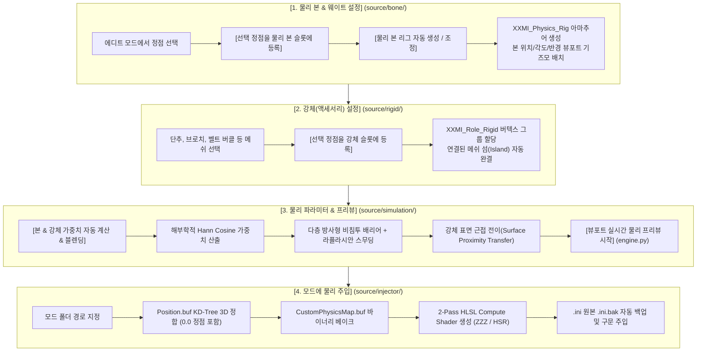

# 1. 시스템 아키텍처 및 파이프라인 (ARCHITECTURE.md)

이 문서는 **XXMI Custom Physics**의 전반적인 모듈 구조, 4단계 워크플로우 파이프라인, 데이터 모델 및 프로퍼티 그룹을 상세히 설명합니다.

---

## 🏗️ 4단계 워크플로우 파이프라인

애드온의 UI는 모더의 작업 순서에 맞춰 4개의 순차적 N-패널(`bl_order` 0~3)로 구성되어 있습니다.



---

## 📦 데이터 구조 및 모델 (Data Architecture)

애드온의 상태는 `source/properties.py`의 `XXMI_PG_custom_physics_props` PropertyGroup에 저장되며, 씬(`context.scene.xxmi_custom_physics_props`) 단위로 영구 보존됩니다.

### 1. 물리 본 슬롯 (`XXMI_PG_bone_slot_item`)
모핑 본의 동적 N개 슬롯을 관리하는 항목입니다:
- `name` (String): 본 식별 이름 (예: `Breast.L`, `Breast.R`, `Tail_01`, `Skirt_Front` 등)
- `bone_type` (Enum): `MORPH` (단일 범용 모핑 타입)
- `data_json` (String): 해당 본에 등록된 오브젝트별 버텍스 인덱스 사전 (JSON 직렬화)
  - 형태: `{"Body": [10, 11, 12, ...], "Costume": [45, 46, ...]}`
- `head` / `tail` (FloatVector3): 본 헤드 및 테일의 3D 월드 좌표
- `radius` (Float): 본의 유효 영향 반경
- `falloff_power` (Float, 기본 1.0): 감쇠 지수 (기저 0.35 보정 적용)
- `peak_weight` (Float, 기본 0.80): 본 중심 최대 모핑 가중치
- `smooth_iterations` (Int, 기본 2): 라플라시안 스무딩 반복 횟수
- `lock_registered_verts` (Bool, 기본 True): 사용자가 등록한 정점 범위 엄격 고정

### 2. 강체 슬롯 (`XXMI_PG_rigid_item`)
변형되지 않고 형태를 유지해야 하는 단추/금속 장신구 슬롯 항목입니다:
- `name` (String): 장신구 명칭 (예: `Chest_Badge`, `Zipper_Puller`, `Pouch`)
- `data_json` (String): 해당 강체에 등록된 오브젝트별 버텍스 인덱스 사전 (JSON 직렬화)
- `weight_scale` (Float, 기본 1.0): 추종 가중치 배율 (기본 100%)

### 3. 글로벌 물리 시뮬레이션 파라미터
- `frequency` (Float, 기본 2.4 Hz): 고유 진동수 (스프링 장력)
- `damping` (Float, 기본 0.45): 감쇠비 (진동 소멸 속도)
- `inertia` (Float, 기본 0.80): 관성 질량 배율
- `gravity_blend` (Float, 기본 0.30): 중력 및 자세에 따른 처짐 반영률
- `max_strength` (Float, 기본 1.0): 최대 변위 한계 클램프 배율
- `breath_scale` (Float, 기본 0.20): 호흡 애니메이션 팽창 배율

---

## 🏷️ 버텍스 그룹 명명 규칙 (Vertex Group Conventions)

블렌더 메쉬 및 인게임 버퍼 매핑 시 사용되는 공식 버텍스 그룹 규칙입니다:

| 버텍스 그룹 이름 | 역할 및 성격 |
|---|---|
| `XXMI_<본이름>` | 각 물리 본 슬롯별 변위 가중치 (예: `XXMI_Breast.L`, `XXMI_Morph_1` 등) |
| `XXMI_Role_Rigid` | 강체(액세서리) 마스크 (가중치 1.0: 완전 강체로 간주되어 내부 모핑 배제) |
| `XXMI_Role_Static` | 물리 계산에서 완전 제외되는 고정 베이스 정점 마스크 |
| `XXMI_Breast_L` / `_R` | 레거시 2본 버전 호환용 폴백 그룹 |

---

## 🛡️ 안전 래퍼 및 블렌더 컨벤션 가이드

에이전트가 코드를 수정하거나 새로운 기능을 추가할 때 반드시 따라야 하는 안전 규칙:

1. **오브젝트/에디트 모드 전환 안전성**:
   ```python
   from .utils import ensure_all_objects_in_object_mode, ensure_object_visible
   
   ensure_all_objects_in_object_mode(context)
   ensure_object_visible(context, obj)
   ```
   - 숨겨진 오브젝트(`hide_viewport=True` 또는 `hide_get()=True`)나 에디트 모드 상태에서 버텍스 그룹을 수정하거나 메쉬 데이터(`obj.data.vertices`)를 직접 접근하면 블렌더에서 크래시가 발생하므로, 항상 안전 래퍼를 호출해야 합니다.

2. **UI 입력 필드 정렬**:
   - 패널의 `draw()` 구현 시 라벨과 슬라이더 정렬을 위해 필수 적용:
   ```python
   layout.use_property_split = True
   layout.use_property_decorate = False
   ```

3. **헤더 커스텀 드로잉**:
   - `bl_label = ""`로 비워두고 `draw_header()`에서 아이콘과 함께 명시:
   ```python
   def draw_header(self, context):
       self.layout.label(text="물리 본 & 웨이트 설정", icon='BONE_DATA')
   ```
