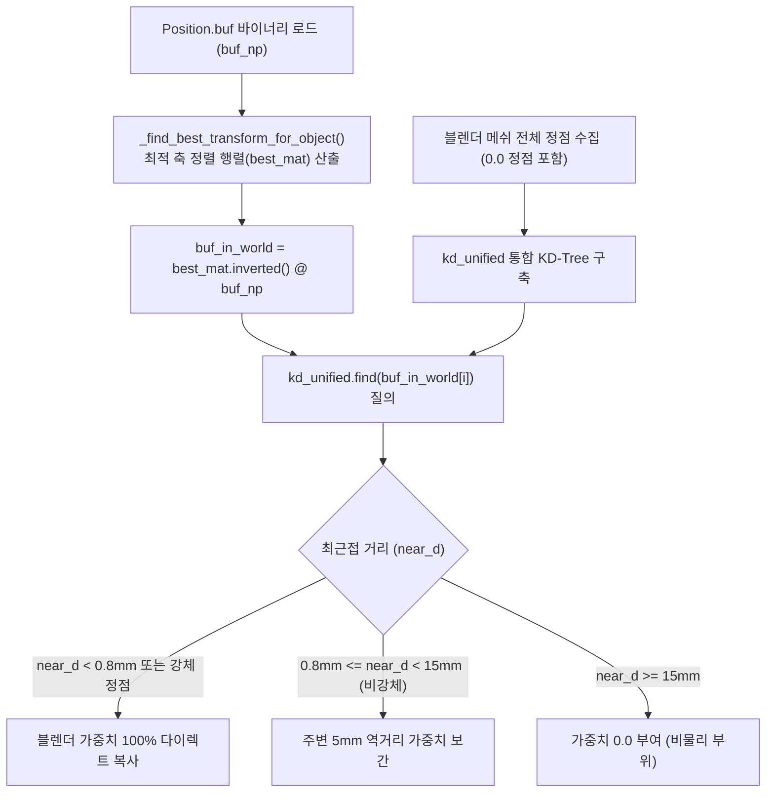

# 4. 모드 주입 파이프라인 및 버퍼 매핑 (INJECTOR_PIPELINE.md)

이 문서는 4패널 모드 주입(`source/injector/`)의 3DMigoto `.ini` 파일 구문 분석, `Position.buf` KD-Tree 매칭 알고리즘, 바이너리 맵 버퍼 생성 및 무손실 롤백 메커니즘을 상세히 다룹니다.

---

## 🔍 1. 3DMigoto INI 파싱 및 버퍼 탐색

3DMigoto 모드는 캐릭터의 3D 정점 데이터를 바이너리 버퍼(`Position.buf`, `Blend.buf`, `TexCoord.buf`, `.ib`)와 `.ini` 스크립트를 통해 GPU에 전달합니다.

### 지원하는 INI 구문 형태
애드온의 파서(`source/injector/ini_parser.py`)는 구형 및 최신 XXMI Tools의 모든 버퍼 선언 형식을 지원합니다:
- `vb0 = ResourcePosition` (바닐라 표준)
- `vb0 = ref ResourcePosition` (참조 바인딩)
- `vb0 = copy ResourcePosition` (복사 바인딩)

---

## 🎯 2. Position.buf 3D 정합 및 통합 KD-Tree 매칭

`Position.buf`의 각 정점에 블렌더에서 계산된 가중치를 정확히 입히기 위해 애드온은 2단계 공간 탐색을 수행합니다:



### ⚠️ 핵심 규칙: 0.0 가중치 정점 누락 금지 및 강체 가중치 완벽 보존
1. **0.0 신체 정점 등록**: 가중치가 0.0인 신체 정점을 KD-Tree에 반드시 함께 등록해야, 목이나 복부 정점이 질의했을 때 0.8mm 이내의 신체 정점과 매칭되어 **정확한 `0.00` 가중치**를 부여받고 외곽 번짐이 원천 차단됩니다.
2. **강체 정점 다이렉트 복사**: 최근접 블렌더 정점이 강체(`unified_rigid_weights > 0.5`)인 경우, 주변 피부 정점과의 반경 블렌딩을 전면 배제하고 해당 강체의 순수 가중치를 다이렉트로 복사합니다.
3. **IB 인덱스 버퍼 테이퍼에서 강체 엄격 제외**: `Position.buf`의 엣지 테이퍼 루프(`operators.py`)에서 `rig_out < 0.5` 마스크를 강제하여, 케이스 외곽 정점이 몸통 정점과의 엣지 차이로 인해 깎여나가 무전기보다 덜 움직이는 현상을 100% 원천 차단합니다.

---

## 💽 3. 맵 버퍼 생성 (`CustomPhysicsMap.buf`)

`Position.buf`의 모든 정점 수($N_{\text{buf}}$)와 동일한 크기로 생성되는 GPU 전용 바이너리 버퍼입니다:
- **포맷**: 정점당 16바이트 (`DXGI_FORMAT_R32G32B32A32_FLOAT` / `float4`)
  - `Offset 0`: $w_0$ (본 0 모핑 가중치, float)
  - `Offset 4`: $w_1$ (본 1 모핑 가중치, float)
  - `Offset 8`: $w_{\text{rigid}}$ (강체 플래그, 1.0 또는 0.0, float)
  - `Offset 12`: 예약 영역 (0.0, float)
- **파일 크기**: $N_{\text{buf}} \times 16 \text{ 바이트}$ (헤더 없는 순수 float4 스트림)

---

## 🛡️ 4. 무손실 백업 및 롤백 메커니즘 (Zero Data Loss)

모드 주입 시 사용자의 소중한 원본 `.ini` 파일이 손상되지 않도록 다중 안전장치가 작동합니다:

1. **자동 백업 파일 생성**:
   - 주입 전 원본 `.ini`를 `<파일명>.ini.bak`으로 자동 복사합니다.
   - 이미 주입된 상태에서 재주입할 경우, 기존 백업 파일의 순수 원본 구문을 추적하여 보존합니다.

2. **메타데이터 태그 주석 삽입**:
   주입 구문 전후에 고유 주석 메타데이터를 함께 기록하여 정확한 구문 블록을 식별합니다:
   ```ini
   ; [XXMI-PHYSICS-VB-START]
   ; [XXMI-PHYSICS-ORIG] vb0 = ref ResourceBodyPosition
   vb0 = ref ResourceCustomPhysicsBodyPosition
   ; [XXMI-PHYSICS-VB-END]
   ```

3. **원클릭 물리 효과 롤백 (`XXMI_OT_rollback_custom_physics`)**:
   - `[XXMI-PHYSICS-ORIG]` 태그를 찾아 원본 한 줄 구문으로 100% 무손실 복원합니다.
   - 주입되었던 `CustomPhysics*` 섹션과 HLSL 파일, 백업 파일(`.ini.bak`)을 깔끔하게 정리합니다.

---

## ⌨️ 5. 인게임 실시간 토글 단축키 주입

디버그 모드(`debug_mode = True`) 활성화 후 모드 주입 시, 인게임에서 단축키(기본 `VK_F9`)로 실시간 비교할 수 있는 토글 섹션이 `.ini`에 자동 주입됩니다:

```ini
[KeyXXMIPhysToggle]
key = VK_F9
type = cycle
$xxmi_phys_enable = 0, 1

[CommandListCustomPhysicsApply]
if $xxmi_phys_enable == 1
    run = CommandListCustomPhysicsExecute
else
    ; 바닐라 상태 렌더링 유지
endif
```

---

## 📥 6. 로더 모듈 (`loader.py`): 모드 설정 역복원

기존에 주입된 모드 폴더를 다른 작업자나 새 세션에서 불러올 때:
- 모드 내의 `CustomPhysicsMap.buf`를 읽어 정점별 가중치를 파싱합니다.
- `Position.buf`의 3D 좌표와 블렌더 메쉬를 역정합하여 블렌더의 버텍스 그룹(`XXMI_Bone_0`, `XXMI_Bone_1`, `XXMI_Role_Rigid`)으로 100% 복원합니다.
- 복원된 정점 데이터를 바탕으로 1패널의 모핑 본 슬롯(`bone_items`) 및 2패널의 강체 슬롯(`rigid_items`)을 자동 재구성합니다.
