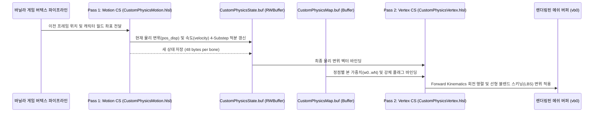

# 3. 물리 시뮬레이션 및 HLSL 셰이더 (PHYSICS_AND_SHADERS.md)

이 문서는 블렌더 뷰포트 프리뷰 엔진(`source/simulation/engine.py`)과 인게임 3DMigoto Compute Shader(`source/injector/zzz.py`, `hsr.py`)의 물리 적분 수식, 상태 버퍼 구조 및 셰이더 아키텍처를 설명합니다.

---

## ⚙️ 1. 4-Substep Symplectic Euler ODE 적분기

블렌더 프리뷰와 인게임 모션의 괴리를 없애기 위해, 양쪽 모두 **4단계 세부 스텝(4-Substep) 심플렉틱 오일러 적분**과 완전히 동일한 물리 방정식을 사용합니다.

### 미분 방정식 (감쇠 조화 진동자 + 관성 가속도)
$$m \ddot{\mathbf{x}} + c \dot{\mathbf{x}} + k \mathbf{x} = \mathbf{F}_{\text{inertial}} + \mathbf{F}_{\text{gravity}} + \mathbf{F}_{\text{breath}}$$

- 고유 각진동수: $\omega = 2\pi \times \text{frequency}$
- 스프링 상수 (단위 질량당): $k = \omega^2$
- 감쇠비 및 감쇠 계수:
  $$\zeta = \text{damping} \times 0.55$$
  $$c = 2.0 \times \omega \times \zeta$$
- 관성 질량 가속도 스케일:
  $$\mathbf{a}_{\text{inertial}} = -12.0 \times \text{inertia} \times \mathbf{a}_{\text{root}}$$
- 최대 변위 한계 (Soft Clamping):
  $$d_{\text{max}} = 0.035 \times \text{max\_strength} \quad (\text{단위: 미터})$$

### 수치 적분 알고리즘 (Substep = 4)
프레임 타임 $\Delta t$를 $N=4$로 분할하여 $dt = \Delta t / 4$:
```text
for step in range(4):
    1. 스프링 복원력 및 외력 계산:
       acc = -k * disp - c * vel + a_inertial + a_gravity + a_breath
    2. 속도 갱신 (Symplectic Euler):
       vel = vel + acc * dt
    3. 변위 갱신:
       disp = disp + vel * dt
    4. 변위 한계 클램프 (구형 바운딩 박스):
       if ||disp|| > d_max:
           disp = normalize(disp) * d_max
           vel = vel - dot(vel, normal) * normal  (벽면 충돌 반사 방지)
```

---

## ⚓ 2. 독립 신체 루트 앵커 (Independent Root Anchors)

각 물리 본($\text{Bone}_0, \text{Bone}_1, \dots, \text{Bone}_{N-1}$)은 절대로 임의의 공통 중심점을 공유하지 않으며, **자신만의 고유한 독립 신체 정점 앵커(`root_indices`)**를 추적합니다:
- 본의 헤드 위치 $\mathbf{H}_i$에 가장 가까우면서,
- 물리 가중치가 전혀 없는 순수 신체 정점 ($w_{\text{sum}} < 0.01$)을 탐색하여 앵커 인덱스로 지정합니다.
- 인게임에서 캐릭터가 달리거나 회전할 때, 각 본의 루트 정점 변위로부터 개별 국소 가속도($\mathbf{a}_{\text{root}, i}$)를 계산하므로 **좌우 가슴이나 트윈테일 헤어가 몸체 회전(Yaw)과 롤(Roll)에 따라 차동 관성 모션**을 보입니다.

---

## 💾 3. 런타임 물리 상태 버퍼 (`CustomPhysicsState.buf`)

인게임 3DMigoto 셰이더가 프레임 간 연속된 물리 상태를 보존하기 위해 사용하는 GPU RWStructuredBuffer 바이너리 레이아웃입니다:
- **크기**: $N_{\text{bones}} \times 3 \times 16 \text{ 바이트}$ ($1\text{본당 } 48\text{바이트}$)

```
[Bone i State Layout] (총 48 Bytes)
Offset 0x00: float4 pos_disp;   // (x, y, z, 0.0) -> 현재 3D 변위
Offset 0x10: float4 velocity;   // (vx, vy, vz, 0.0) -> 현재 3D 속도
Offset 0x20: float4 anchor_prev;// (x, y, z, 0.0) -> 이전 프레임 루트 앵커 좌표
```

---

## ⚡ 4. 2-Pass HLSL Compute Shader 아키텍처

인게임 주입 시 3DMigoto 환경에 맞춰 2개의 패스로 분리된 고성능 HLSL Compute Shader를 실행합니다:



### Pass 1: Motion Compute Shader
- 실행 빈도: 프레임당 1회 (스레드 $N_{\text{bones}}$개 구동)
- 역할:
  - 앵커 정점의 프레임 간 변위로부터 캐릭터 이동 속도/가속도 도출
  - 관성력, 호흡 사인파 변위, 중력 처짐 벡터 합성
  - 4-Substep Symplectic Euler 수치 적분 수행
  - `pos_disp`를 `CustomPhysicsState.buf`에 기록

### Pass 2: Vertex Transform Compute Shader
- 실행 빈도: 캐릭터 드로우콜 직전 (스레드 $N_{\text{vertices}}$개 구동)
- 역할:
  - 각 정점의 `CustomPhysicsMap.buf`에서 가중치 $(w_0, w_1, \dots, w_{\text{rigid}})$를 로드
  - 가중치가 $0.0$인 정점은 조기 반환(`early out`)하여 성능 저하 없음
  - 다관절 FK 회전 행렬과 선형 변위를 결합하여 정점 좌표($\mathbf{P}_{\text{new}}$)를 계산:
    $$\mathbf{P}_{\text{new}} = \mathbf{P}_{\text{orig}} + \sum_{i=0}^{N-1} w_i \cdot \mathbf{D}_i$$
  - `vb0` 정점 버퍼에 최종 변형된 정점을 기록하여 렌더링

---

## 🧭 5. 좌표계 변환 규칙 (DirectX vs Blender)

- **Blender**: Z-Up, Right-Handed 계열 ($(X, Y, Z)_{\text{blender}} = (\text{우}, \text{후}, \text{상})$)
- **DirectX (3DMigoto Buffer)**: Y-Up, Left-Handed 계열 ($(X, Y, Z)_{\text{dx}} = (\text{우}, \text{상}, \text{전})$)

애드온의 `source/injector/operators.py` 및 `source/utils.py`는 `_find_best_transform_for_object()`를 통해 블렌더 메쉬 좌표와 `Position.buf` 간의 축 정렬 행렬(`best_mat`)을 자동 계산합니다:
- 버퍼 공간 정점 $\mathbf{P}_{\text{buf}}$를 블렌더 월드 공간으로 변환할 때:
  $$\mathbf{P}_{\text{world}} = \text{best\_mat}^{-1} \cdot \mathbf{P}_{\text{buf}}$$
- 이 변환을 거친 후 KD-Tree를 질의해야 오차 없이 $1:1$로 정확한 가중치가 전달됩니다.
